<div align="center">

# Deep Autoencoders for ADL Anomaly Detection in Elderly Smart Homes

**Unsupervised detection of deviations in the daily routine of an elderly person living alone, from residential electricity consumption.**


-informational)


[**Full report (PDF)**](docs/report.pdf) | [Results](#6-results) | [Dashboards](#7-dashboards) | [Limitations](#8-validity-limitations-and-non-claims) | [Reproduce](#11-reproducing-the-work) | [Cite](#14-citation)

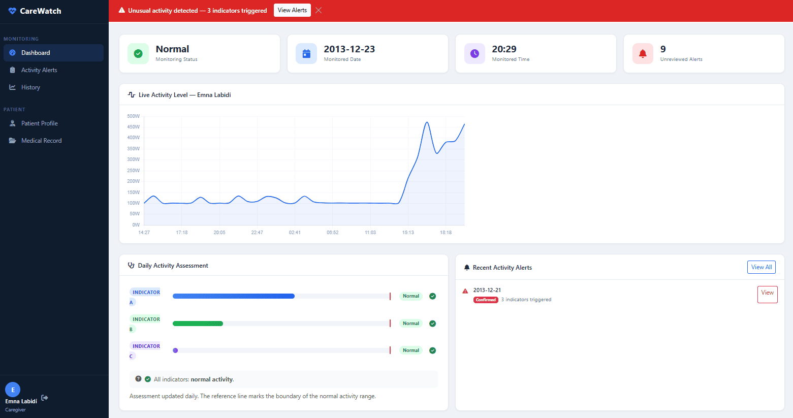

<sub>CareWatch, the caregiver-facing monitoring prototype: live activity chart, status banner, daily assessment indicators and recent alerts.</sub>

</div>

---

## Contents

1. [At a glance](#1-at-a-glance)
2. [Motivation and research question](#2-motivation-and-research-question)
3. [Method](#3-method)
4. [Data](#4-data)
5. [Models, training and scoring](#5-models-training-and-scoring)
6. [Results](#6-results)
7. [Dashboards](#7-dashboards)
8. [Validity, limitations and non-claims](#8-validity-limitations-and-non-claims)
9. [Research directions](#9-research-directions)
10. [Repository layout](#10-repository-layout)
11. [Reproducing the work](#11-reproducing-the-work)
12. [Ethics and intended use](#12-ethics-and-intended-use)
13. [Authors and supervision](#13-authors-and-supervision)
14. [Citation](#14-citation)
15. [License](#15-license)

---

## 1. At a glance

| | |
|---|---|
| **Problem** | Detect abnormal days in an occupant's routine without wearables or cameras, when **no labelled anomalies exist** |
| **Signal** | Whole-home smart-meter power plus up to nine appliance sub-meters |
| **Data** | [REFIT](https://pureportal.strath.ac.uk/en/datasets/refit-electrical-load-measurements-cleaned): 20 UK households, 2013-2015, 8 s sampling. Main case: **House 15** (single occupant) |
| **Unit of analysis** | One day = a `(1440, 10)` tensor (1-minute resolution, 1 aggregate + 9 appliance channels) |
| **Models** | TCN autoencoder, LSTM autoencoder with a **temporal bottleneck**, patch-based Transformer autoencoder |
| **Score** | Per-day reconstruction MSE on the aggregate channel; threshold = percentile of the model's own training errors |
| **Outputs** | Flagged days, model agreement (0 to 3), ADL-typed labels such as "Unusual Washing Machine usage" |
| **Evaluation** | Plausibility and agreement, **not** precision/recall (REFIT has no behavioural anomaly labels) |

### Findings

1. **Per-house training is necessary.** Trained on Houses 1-4 and tested on House 5, the 10-channel models flag 9.1 % to 59.1 % of days, which is implausible; per-occupant training flags 0 to 4 of 113 days.
2. **A common LSTM autoencoder design fails on day-long sequences, and the failure is fixable.** A global bottleneck (one 64-d vector for 1440 steps) made the decoder collapse and flag **0 days**; a per-timestep bottleneck restored detection.
3. **Detection is consistent across three inductive biases on one event.** 2015-07-03 is flagged by the TCN, the LSTM and the Transformer (95th-percentile threshold).
4. **On this household, appliance sub-metering mattered.** With aggregate-only input, the two TCN detections at the 99th percentile disappear (based on two events, so a hypothesis rather than a general result).
5. **Detections map to caregiver-readable ADL labels** (laundry, dishwashing, television), through a four-layer typing module.

---

## 2. Motivation and research question

Ageing in place is widely preferred, but people living alone can suffer health events that go unnoticed for hours or days. Changes in Activities of Daily Living (ADL), such as meal preparation, laundry or sleep timing, are early indicators of decline. Wearables are often refused or forgotten, and cameras raise privacy concerns. Smart meters are already installed in millions of homes and are non-intrusive.

> **Research question.** Can deep models trained on a person's historical electricity consumption detect deviations from their routine reliably enough to form the basis of a remote monitoring alert system?
>
> **Answer.** A qualified yes: on a single-occupant household with appliance sub-metering, the models detect behaviourally plausible events. The qualification is that this relies on sub-metering and has **not** been validated against clinical ground truth.

### Design decisions

| Decision | Rationale |
|---|---|
| Unsupervised autoencoders | No behavioural anomaly labels exist in REFIT; supervised methods do not apply |
| Three architectures | Different inductive biases: local (TCN), recurrent (LSTM), global attention (Transformer); agreement is used as a confidence signal |
| Per-house specialisation | One occupant's routine is the reference for their own anomalies (supported by the cross-house experiment) |
| Day-level granularity | Meal, laundry and sleep routines are visible at the daily scale |
| Percentile thresholds | Training-error distributions are right-skewed; a z-score rule gave overly conservative thresholds on small training sets |

---

## 3. Method

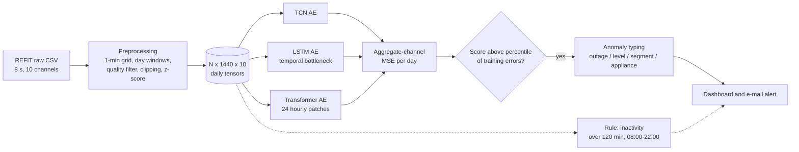

**Online phase.** At each simulated day boundary the three trained autoencoders reconstruct the 1440-minute day; the aggregate-channel MSE is compared to each model's calibrated threshold; flagged days go to the typing module; a separate rule-based check raises inactivity alerts.

---

## 4. Data

**Dataset.** REFIT (Murray, Stankovic and Stankovic, *Scientific Data*, 2017): 20 households around Loughborough, UK, 2013-2015, one aggregate channel and up to nine Individual Appliance Monitors per house, 8-second cadence, CC BY 4.0. **The data is not included in this repository.**

### Household selection

All 20 households were assessed against four criteria; the full assessment table is in the report (Table 2.2).

| ID | Criterion | Why it matters |
|---|---|---|
| C1 | Single occupant | One-to-one mapping between signal and behaviour |
| C2 | No solar contamination of the aggregate | Generation offsets consumption and is not behavioural |
| C3 | About 350 or more clean training days | Reliable training and threshold calibration |
| C4 | ADL-relevant appliance set | Alerts must map to actions a caregiver understands |

House 15 is the only household satisfying all four. House 11, the other single-occupant house, is rejected for solar contamination of its aggregate channel.

### House 15 channels

| Ch. | Appliance | ADL category |
|---|---|---|
| 0 | Aggregate | Total household consumption |
| 1 | Fridge-Freezer | Nutrition (continuous baseline) |
| 2 | Tumble Dryer | Laundry |
| 3 | Washing Machine | Laundry |
| 4 | Dishwasher | Domestic cleaning |
| 5 | Desktop Computer | Occupation |
| 6 | Television | Leisure |
| 7 | Microwave | Nutrition (meal preparation) |
| 8 | Hi-Fi | Leisure |
| 9 | Toaster | Nutrition (breakfast) |

### Preprocessing and split

Resampling to a 1-minute grid (forward-fill, consistent with REFIT firmware semantics), midnight-aligned 24 h windows, removal of outage days (more than 30 % of aggregate readings below 10 W) and flat sensor-gap days (aggregate std below 5 W) **from the training set only**, per-channel clipping at the training 99.9th percentile, per-channel z-score. All statistics are fitted on the training set and applied unchanged to validation and test (no leakage). The split is **chronological**, which simulates deployment: train on the past, evaluate on the future.

| Split | Days | Tensor shape | Notes |
|---|---|---|---|
| Train | 379 | (379, 1440, 10) | 398 days minus 19 flat days |
| Validation | 56 | (56, 1440, 10) | not filtered |
| Test | 113 | (113, 1440, 10) | not filtered, so anomalies remain visible |
| **Total** | **567** complete days | | |

---

## 5. Models, training and scoring

| Model | Parameters | Bottleneck | Context mechanism | Granularity |
|---|---|---|---|---|
| **TCN autoencoder** | 311,834 | 16-channel 1x1 conv | Dilated causal convolutions (dilations 1, 2, 4, 8; channels 32, 64, 128, 64) | per minute |
| **LSTM autoencoder** | 485,834 | 64-d **per timestep** | 2-layer recurrent state, hidden size 128 | per minute |
| **Transformer autoencoder** | 1,148,632 | encoder memory | Self-attention over 24 hourly patch tokens (`d_model` 128, 4 heads, 3 + 3 layers, Pre-LN) | per hour |

All models take and return `(B, 1440, 10)`. The Transformer flattens each 60-minute patch of 10 channels into a 600-d vector, which keeps attention at 24 tokens instead of 1440.

**Training.** Weighted MSE (aggregate channel weighted 3x), Adam (LR 1e-3), ReduceLROnPlateau (factor 0.5, patience 7), gradient clipping at 1.0, early stopping (patience 15, best weights restored), batch size 32, at most 100 epochs.

**Anomaly score and threshold.**

$$s_i = \frac{1}{T}\sum_{t=1}^{T}\left(\hat{x}_{i,t,0}-x_{i,t,0}\right)^2 \qquad \tau_p = \mathrm{Percentile}_p\left(\{s_i^{\mathrm{train}}\}\right)$$

A day is flagged when $s_i > \tau_p$, with each model calibrated **independently** (default $p = 99$; $p = 95$ also evaluated). Detection uses the aggregate channel only; appliance channels influence the latent representation and are used for typing.

**Four-layer anomaly typing** (runs on flagged days):

| Layer | Check |
|---|---|
| 1. Outage / inactivity | Rule: more than 30 % of aggregate readings below 10 W overrides the model flag |
| 2. Global level | Daily mean vs. training mean +/- 2 sigma |
| 3. Time-of-day segment | Night, morning, afternoon, evening error vs. baseline (mean + 2.5 sigma) |
| 4. Appliance | Per-channel error vs. mean + 2.5 sigma, mapped to an ADL category and a severity (mild, notable, severe) |

---

## 6. Results

### 6.1 Evaluation protocol

REFIT has no labelled behavioural anomalies, so precision, recall and F1 are **not applicable**. The evaluation uses: the number and dates of flagged days; the percentile rank of each score; model agreement (0 to 3 models); reconstruction plots as qualitative evidence; and the plausibility of the ADL labels. See [section 8](#8-validity-limitations-and-non-claims) for what this does and does not support.

### 6.2 Per-house evaluation (House 15, 113 test days)

| Model | 99th-pct threshold | Flags @ 99th | 95th-pct threshold | Flags @ 95th |
|---|---|---|---|---|
| TCN | 5.04e-2 | **2** | 2.92e-2 | **4** |
| LSTM (temporal bottleneck) | 3.51e-2 | 0 | 2.05e-2 | **3** |
| Transformer | 2.47e-1 | 0 | 1.61e-1 | **1** |

About 1 false positive is expected over 113 days at the 99th percentile, so the TCN's 2 flags are consistent with a calibrated model on a continuing routine.

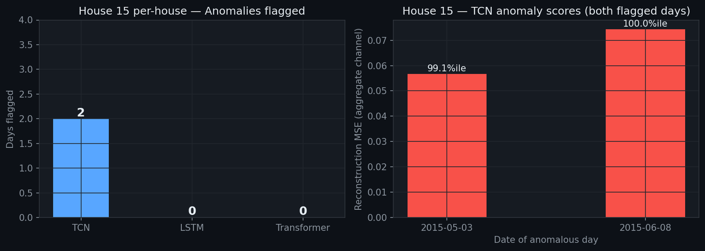

**TCN detections at the 99th percentile**

| Date | Score | Percentile | Severity | Label |
|---|---|---|---|---|
| 2015-05-03 | 0.0568 | 99.1st | Mild | Unusual Washing Machine usage |
| 2015-06-08 | 0.0743 | 100th (above every training day) | Extreme | Unusual Washing Machine usage |

### 6.3 Threshold sensitivity and model agreement

Lowering the threshold to the 95th percentile yields **five distinct days**, at the cost of about 6 expected false positives per 113 days:

| Date | TCN | LSTM | Transformer | Typed label |
|---|:---:|:---:|:---:|---|
| 2015-04-27 | yes | | | Unusual Washing Machine usage |
| 2015-05-03 | yes | | | Unusual Washing Machine usage |
| 2015-06-08 | yes | yes | | Unusual Washing Machine usage |
| **2015-07-03** | **yes** | **yes** | **yes** | Unusual Dishwasher + Television usage |
| 2015-07-04 | | yes | | Unusual Fridge-Freezer + Television usage |

**2015-07-03 is flagged by all three architectures** and is the highest-confidence detection. The Transformer, whose hourly patches smooth minute-level timing deviations, flags only this day.

<p align="center">
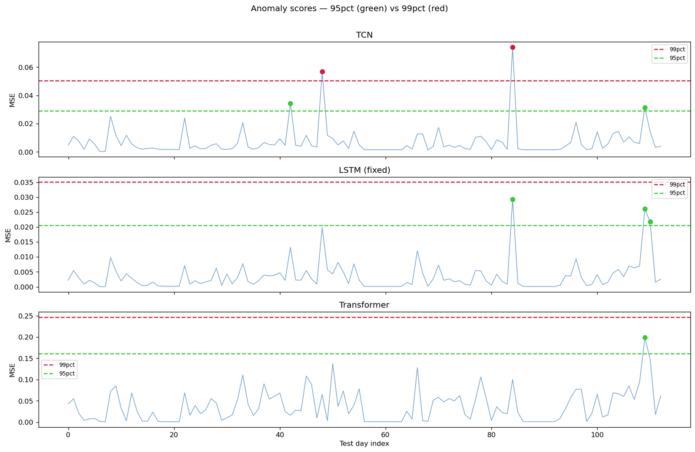<br/>
<sub>Daily anomaly scores per model; dashed lines mark the 99th (red) and 95th (green) percentile thresholds.</sub>
</p>

<details>
<summary><b>Reconstruction plots, error distributions and model agreement</b></summary>

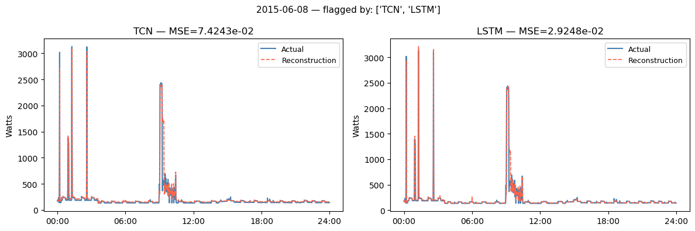

*2015-06-08 (TCN and LSTM): a large mid-morning divergence between actual and reconstructed aggregate power.*

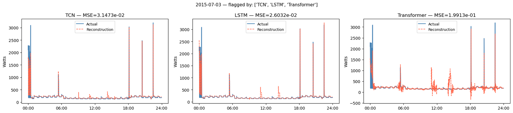

*2015-07-03 (all three models): attributed by the typing module to unusual Dishwasher and Television usage in the late afternoon and evening.*

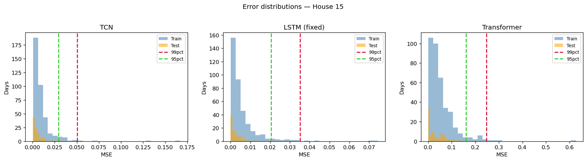

*Training vs. test reconstruction-error distributions with the 99th and 95th percentile thresholds.*

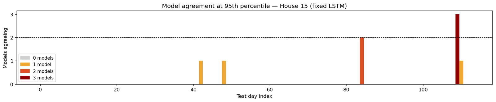

*Number of models (0 to 3) flagging each test day at the 95th percentile.*

</details>

### 6.4 Aggregate-only vs. sub-metering (House 15)

With only the aggregate channel as input, all three models flag **0 days** at the 99th percentile: the two TCN detections are lost. The 10-channel TCN encodes appliance and aggregate signals in a shared bottleneck, so an unusual washing-machine pattern degrades the aggregate reconstruction; the 1-channel TCN has never learned that association. Appliance channels therefore raised detection sensitivity here, in addition to enabling typing. This rests on two events and should be read as a hypothesis.

<p align="center">
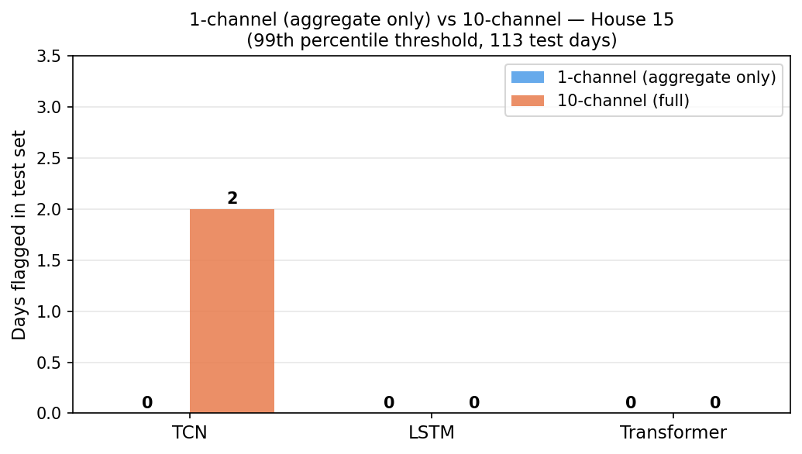
</p>

### 6.5 Cross-house evaluation (train Houses 1-4, test House 5, 648 days)

| Model | 10 channels | Aggregate only |
|---|---|---|
| TCN | 383 flags (59.1 %) | 2 (0.3 %) |
| LSTM | 276 flags (42.6 %) | 5 (0.8 %) |
| Transformer | 59 flags (9.1 %) | 17 (2.6 %) |

Two causes are identified. **Distribution shift** between households, and **appliance channel-index mismatch** (the same channel index is a different appliance in different houses; for example channel 1 is the Toaster in House 3 and the Fridge-Freezer in House 5). The aggregate-only models are immune to the second cause and flag far fewer days, which indicates that most 10-channel cross-house flags are artefacts. These are flag rates, not accuracy measures; they show that a model must be specialised to the occupant it monitors.

<p align="center">
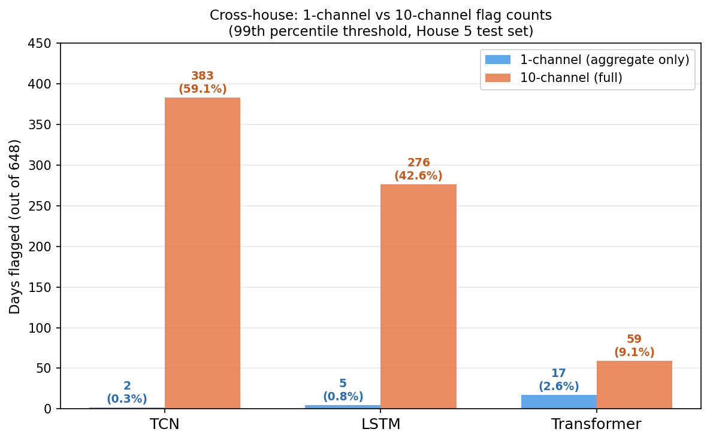
</p>

### 6.6 Case study: the LSTM global-bottleneck failure

| | Global bottleneck (standard design) | Temporal bottleneck (this work) |
|---|---|---|
| Latent | one 64-d vector for 1440 steps | one 64-d vector **per timestep** |
| Behaviour | decoder converges to a fixed output after about 50 steps and ignores the latent | decoder is conditioned at every step |
| Symptom | every training day had nearly the same, high error, inflating the 99th-percentile threshold beyond any test day | normal and anomalous days are separable |
| Flags on House 15 test (99th pct) | **0 of 113** | detects 3 days at the 95th pct, 2 shared with the TCN |

The fix applies the compression and expansion as linear layers over the encoder's full output sequence instead of its final hidden state.

---

## 7. Dashboards

Two applications consume the models' outputs.

### 7.1 CareWatch (Flask): caregiver-facing prototype

Described in the report (section 3.8). It replays the House 15 data at 60 simulated minutes per real second and runs inference at each day boundary.

- **Architecture.** A `SimulationManager` daemon thread (protected by a reentrant lock), an `InferenceEngine` (three models plus the typing module), five Flask blueprints (auth, dashboard, log, api, dossier) and SQLAlchemy over SQLite. The browser polls `/api/tick` every second; alerts are persisted and e-mailed through SMTP on a background thread.
- **Caregiver-first design.** No AI vocabulary reaches the interface: the three models appear as Indicators A, B and C, and raw errors become risk badges (Normal, Elevated, Alert).
- **Inactivity rule.** Longest run below 50 W during 08:00-22:00; an alert is raised above 120 minutes (low under 3 h, medium 3-5 h, high above 5 h), independently of the models.

| Page | Content |
|---|---|
| Dashboard `/` | Status banner, live power chart, three indicator badges, unread alerts |
| Activity Alerts `/alerts` | Paginated events with severity and acknowledgement status |
| Alert Detail `/alerts/<id>` | Indicator bars or inactivity window, observations, caregiver notes |
| History `/historique` | Period selector (14 days, 3 months, 18 months), severity and type charts |
| Patient Profile `/dossier` | Structured profile, contacts, medications, lab results |

<p align="center">
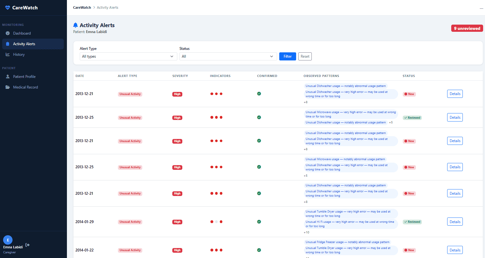
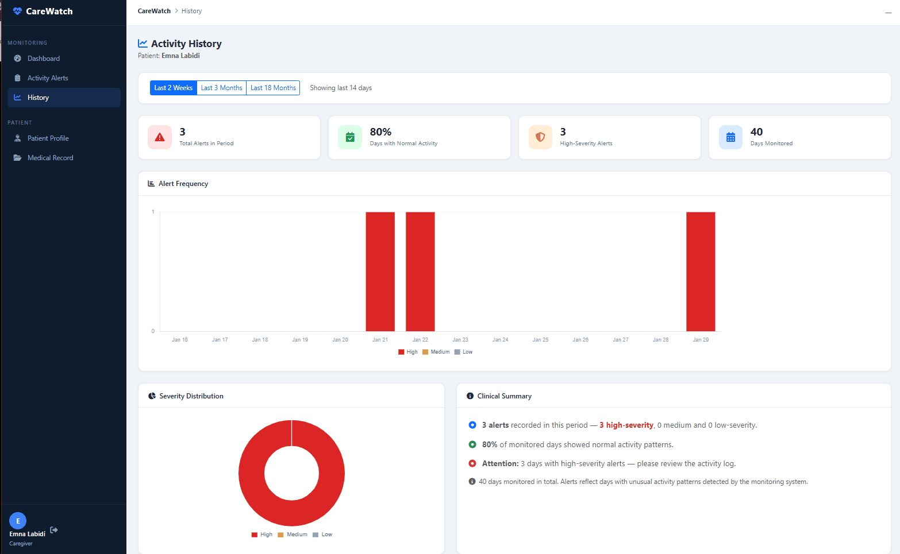
</p>

<details>
<summary><b>More screenshots and UML diagrams</b></summary>

<p align="center">
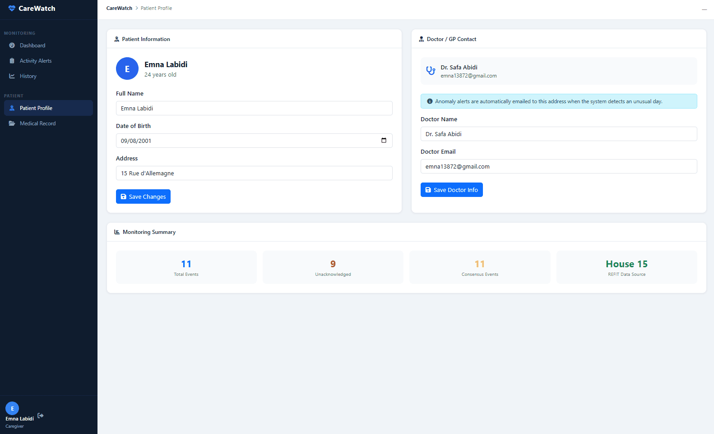
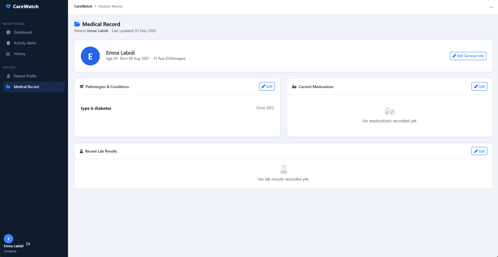
</p>

<p align="center">
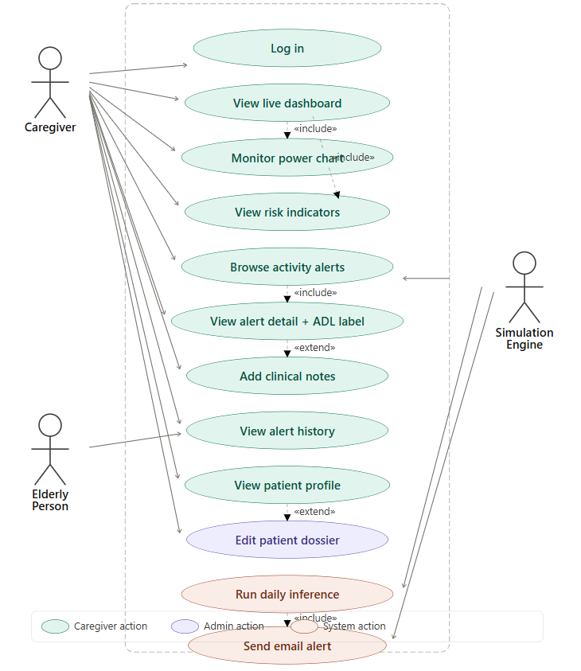
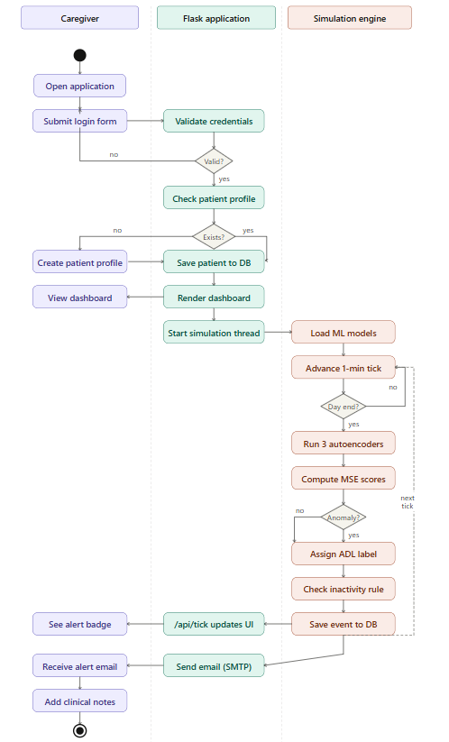
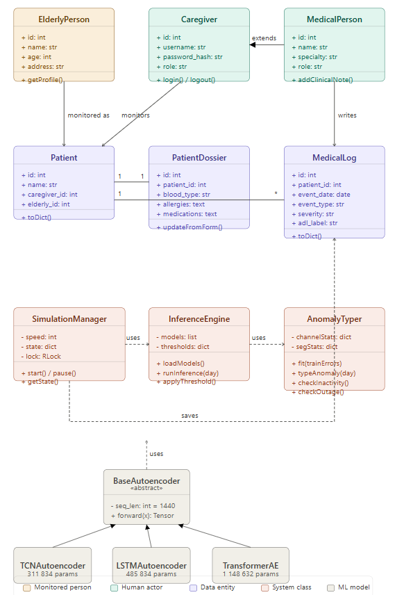
</p>

</details>

### 7.2 Research dashboard (FastAPI + React): multi-household exploration

Processes minute-level data from several REFIT households, scores each day with the trained autoencoder and lets researchers explore the results.

| Layer | Technology |
|---|---|
| Frontend | React, TypeScript, Vite, Tailwind CSS, Recharts |
| Backend | FastAPI (Python) |
| Model | PyTorch (LSTM autoencoder) |
| Preprocessing | scikit-learn (`StandardScaler`) |

| Page | Description |
|---|---|
| Overview | Anomaly-score summary across houses |
| Alerts | Filterable table of flagged days |
| Day Detail | Signal vs. reconstruction for a chosen day |
| Statistics | Trends and distributions over time |
| Comparison | Behaviour patterns compared across houses |

<!-- TODO: state clearly which application (7.1 or 7.2) lives in which folder of this repository. -->

---

## 8. Validity, limitations and non-claims

> [!IMPORTANT]
> This is a research prototype. It has **not** been validated against clinical ground truth and is **not** a medical device.

**What the evidence supports**
- Per-occupant training behaves sensibly (0 to 4 flags in 113 days), while cross-house training over-flags massively.
- Reconstruction errors on the flagged days are high, the reconstruction plots show localised divergences, and the typed labels correspond to concrete household activities.
- One event (2015-07-03) is detected by three architectures with different inductive biases.

**What it does not support**
- **No accuracy claims.** Without labels, flag rates and agreement are proxies; they do not measure precision or recall, and agreement has not been shown to reduce false positives.
- **No generalisation claim.** All per-house results come from one household (House 15), with 2 to 5 detections in total, so relative model sensitivity is tentative.
- **No deployment claim.** The threshold is static (calibrated once on training data); gradual routine drift would require re-calibration.
- **Sub-metering finding is exploratory.** It rests on two flagged days.

**Known caveats in the experiments**
- Thresholds are calibrated per model on its own training errors, so flag counts are not directly comparable across architectures.
- The cross-house experiment mixes a distribution shift and a channel-index mismatch; the aggregate-only control separates them only approximately.

---

## 9. Research directions

The central limitation, the absence of ground truth, motivates the next step:

1. **Synthetic ADL datasets with known ground truth.** Generate long activity logs from behavioural models, vary parameters, and inject anomalies derived from medical descriptions of symptoms (type, frequency, time of occurrence). This enables quantitative evaluation (precision, recall, detection delay) and fair comparison of methods, which this study could not provide.
2. **Beyond electricity.** Event logs from other modalities (for example acoustic events for sleep, meals and social interaction) with the same typing and reporting logic.
3. **Adaptive thresholds.** Sliding-window re-calibration to follow baseline drift.
4. **Multi-house pre-training with per-house fine-tuning**, to reduce the cold-start data requirement.
5. **Intra-day detection** with 2 h to 6 h windows, for earlier alerts.
6. **Clinical validation** against carer diaries or GP records.
7. **Live smart-meter integration** in place of the CSV replay.

---

## 10. Repository layout

Entries marked `(existing)` are in the repository today; entries marked `(to add)` are recommended additions that the sections above refer to.

```text
.
|-- README.md                         (existing)
|-- CITATION.cff                      (to add)
|-- LICENSE                           (to add)
|-- docker-compose.yml                (existing)
|-- .gitignore                        (existing)
|-- docs/
|   |-- report.pdf                    (to add) full project report
|   `-- figures/                      (to add) figures used in this README
|-- backend/                          (existing) research dashboard API
|   |-- main.py                       FastAPI entry point
|   |-- requirements.txt
|   |-- data/                         REFIT CSV files (not included)
|   |-- model/                        trained weights and scaler (not included)
|   |-- routers/                      anomalies.py, days.py, houses.py, stats.py
|   |-- schemas/responses.py
|   `-- services/                     data_service.py, model_service.py, scoring_service.py
|-- frontend/                         (existing) React + TypeScript UI
|   `-- src/                          pages/, components/, services/api.ts, types/index.ts
|-- src/                              (to add) preprocessing, models, training, evaluation
|-- notebooks/                        (to add) experiments and figure generation
`-- carewatch/                        (to add) Flask caregiver-facing prototype
```

<!-- TODO: adjust this tree to match the real repository before publishing. -->

---

## 11. Reproducing the work

### 11.1 Data

Download the cleaned REFIT files from the University of Strathclyde portal:
<https://pureportal.strath.ac.uk/en/datasets/refit-electrical-load-measurements-cleaned>

For the research dashboard, place the files in `backend/data/` as `CLEAN_House1.csv` to `CLEAN_House5.csv`. For the House 15 experiments, add `CLEAN_House15.csv` as well.

### 11.2 Environment

```bash
git clone https://github.com/AhmedBenRahma/ADL-Anomaly-Detection-.git
cd ADL-Anomaly-Detection-
python -m venv .venv && source .venv/bin/activate   # Windows: .venv\Scripts\activate
pip install -r backend/requirements.txt
```

Python 3.10 and PyTorch 2.0 were used. Training uses a CUDA GPU when available and falls back to CPU.

### 11.3 Preprocess, train and evaluate

```bash
# TODO: replace with the real entry points of your scripts or notebooks
python -m src.preprocessing.build_house15
python -m src.training.train --model tcn          # also: lstm, transformer
python -m src.evaluation.evaluate --percentile 99  # also: 95
```

**Sanity check.** A correct run on House 15 should land close to these counts (test split, 113 days):

| Model | Flags @ 99th | Flags @ 95th |
|---|---|---|
| TCN | 2 | 4 |
| LSTM | 0 | 3 |
| Transformer | 0 | 1 |

Small deviations are expected from training stochasticity. <!-- TODO: document the random seeds if fixed. -->

### 11.4 Pretrained weights

Place the trained files in `backend/model/`:

```text
backend/model/
|-- lstm_autoencoder_model.pth
`-- scaler.pkl
```

> The scaler is saved with **joblib**: load it with `joblib.load()`, not `pickle.load()`. It was fitted with scikit-learn 1.6.1; a version warning on startup is normal. <!-- TODO: rename "scaler (1).pkl" to scaler.pkl in the code and files. -->

### 11.5 Run the research dashboard

```bash
# backend
cd backend
pip install -r requirements.txt
python -m uvicorn main:app --reload      # http://127.0.0.1:8000  (API docs: /docs)

# frontend (new terminal)
cd frontend
npm install
npm run dev                              # http://localhost:5173
```

Or with Docker: `docker-compose up`. The first backend start can take several minutes because the model scores all CSV files; later starts are faster if caching is enabled. Prerequisites: Python 3.10+, Node.js 18+, Git.

### 11.6 Run CareWatch

<!-- TODO: add the exact commands to start the Flask app (dependencies, database initialisation, SMTP settings, replay speed). -->

---

## 12. Ethics and intended use

- **Privacy by design.** Only electrical power is used: no cameras, microphones or wearables. Energy data can still reveal routines, so any real deployment would require informed consent and data-protection safeguards.
- **Intended use.** Decision support that prompts a welfare check by a caregiver; never an autonomous diagnosis.
- **Prototype scope.** The interface replays historical REFIT data; the patient profile and medical record pages demonstrate the design.
- **Fairness and transfer.** The models are specialised to one household's routine; behaviour in other homes, cultures or living situations has not been studied.

---

## 13. Authors and supervision

| | |
|---|---|
| **Ahmed Ben Rahma** | <!-- TODO: state your contributions precisely (for example: preprocessing pipeline, TCN and LSTM models, evaluation, dashboard) --> |
| **Emna Abidi** | <!-- TODO: state her contributions precisely --> |
| **Supervisor** | Dr. Chiraz Houaidia, ENSI, University of Manouba |

Design and Development Project (PCD), National School of Computer Science (ENSI), University of Manouba, academic year 2025-2026, submitted in partial fulfilment of the National Engineering Diploma.

---

## 14. Citation

Please cite the report and the dataset. GitHub's "Cite this repository" button reads `CITATION.cff`.

```bibtex
@techreport{benrahma2026adl,
  title       = {Deep Learning Autoencoders for ADL Anomaly Detection in Elderly Smart Homes},
  author      = {Ben Rahma, Ahmed and Abidi, Emna},
  institution = {National School of Computer Science (ENSI), University of Manouba},
  year        = {2026},
  type        = {Design and Development Project Report (PCD)}
}

@article{murray2017refit,
  title   = {An electrical load measurements dataset of United Kingdom households from a two-year monitoring study},
  author  = {Murray, David and Stankovic, Lina and Stankovic, Vladimir},
  journal = {Scientific Data},
  volume  = {4},
  pages   = {160122},
  year    = {2017}
}
```

---

## 15. License

<!-- TODO: choose a licence (for example MIT) and add a LICENSE file. The REFIT dataset is distributed under CC BY 4.0 and must be attributed separately. -->
